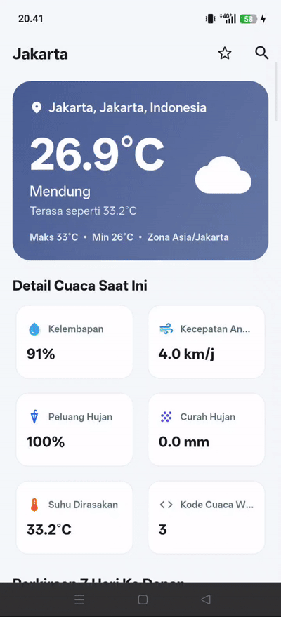

# Identitas Mahasiswa

- Nama: Nalendra Wicaksana
- NIM: H1D024073
- Shift KRS: E
- Shift Baru: D

# Aplikasi Cuaca Flutter (MVVM + Open-Meteo API)

Proyek ini dibuat untuk memenuhi penugasan **Responsi Flutter** dengan menerapkan arsitektur **Model-View-ViewModel (MVVM)**, konsumsi REST API **Open-Meteo** (Weather Forecast & Geocoding), pengelolaan state menggunakan **Provider**, serta penyimpanan lokal menggunakan **SharedPreferences**.

## 1. Struktur Aplikasi (MVVM)

```text
lib/
├── main.dart                          # Entry point & inisialisasi MultiProvider + MaterialApp
├── theme/
│   └── app_theme.dart                 # Konfigurasi Material 3 ThemeData & Typography
├── utils/
│   └── weather_code_helper.dart       # Mapping WMO weather_code & format tanggal
├── models/
│   ├── location_model.dart            # Model data lokasi (Geocoding & Local Storage)
│   └── weather_model.dart             # Model data cuaca saat ini & perkiraan harian
├── services/
│   ├── weather_api_service.dart       # HTTP GET ke Open-Meteo Forecast & Geocoding API
│   └── local_storage_service.dart     # Persistensi lokasi favorit, riwayat, & lokasi terakhir
├── viewmodels/
│   ├── weather_viewmodel.dart         # State cuaca utama, loading/empty/error, & favorit
│   └── search_viewmodel.dart          # State pencarian kota & riwayat pencarian
└── views/
    ├── home_screen.dart               # Screen 1: Informasi cuaca terkini & perkiraan 7 hari
    ├── search_screen.dart             # Screen 2: Pencarian kota, favorit, & riwayat
    └── widgets/
        ├── weather_metric_card.dart   # StatelessWidget kartu metrik cuaca
        └── daily_forecast_tile.dart   # StatelessWidget item perkiraan harian
```

## 2. Penerapan Arsitektur MVVM

- **Model (`lib/models/`)**: Merepresentasikan struktur data dari respons JSON API dan penyimpanan lokal (`LocationModel`, `CurrentWeather`, `DailyForecast`, `WeatherResponse`).
- **Service (`lib/services/`)**: Menangani komunikasi eksternal, yaitu HTTP `GET` ke REST API Open-Meteo (`WeatherApiService`) dan penyimpanan lokal `SharedPreferences` (`LocalStorageService`).
- **ViewModel (`lib/viewmodels/`)**: Menggunakan `ChangeNotifier` (`WeatherViewModel` & `SearchViewModel`) sebagai penghubung antara `Service`/`Model` dan `View`. ViewModel menyimpan status tampilan (`loading`, `loaded`, `empty`, `error`) dan memanggil `notifyListeners()` setiap kali data berubah.
- **View (`lib/views/`)**: Menampilkan antarmuka Material Design secara responsif dan hanya bereaksi terhadap perubahan state dari ViewModel tanpa menaruh logika HTTP request langsung di dalam widget.

## 3. Implementasi API Open-Meteo

1. **Geocoding API (Pencarian Kota)**
   - Endpoint: `GET https://geocoding-api.open-meteo.com/v1/search?name={kota}&count=10&language=id&format=json`
   - Digunakan pada `SearchScreen` untuk mencari koordinat (`latitude`, `longitude`) dari nama kota yang diketik pengguna.
2. **Weather Forecast API (Data Cuaca)**
   - Endpoint: `GET https://api.open-meteo.com/v1/forecast?latitude={lat}&longitude={lon}&current=temperature_2m,relative_humidity_2m,apparent_temperature,precipitation,weather_code,wind_speed_10m&daily=weather_code,temperature_2m_max,temperature_2m_min,precipitation_probability_max&timezone=auto`
   - Menampilkan seluruh field wajib: suhu saat ini, kelembapan, suhu dirasakan, curah hujan, kode cuaca, kecepatan angin, suhu maksimum/minimum harian, serta peluang hujan maksimum.

## 4. Cara Menjalankan Proyek

```bash
flutter pub get
flutter run
```

## 5. Demo Aplikasi


